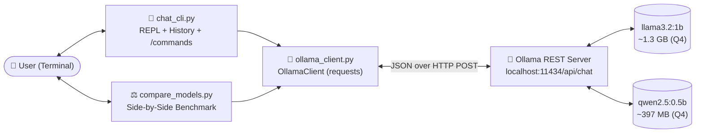
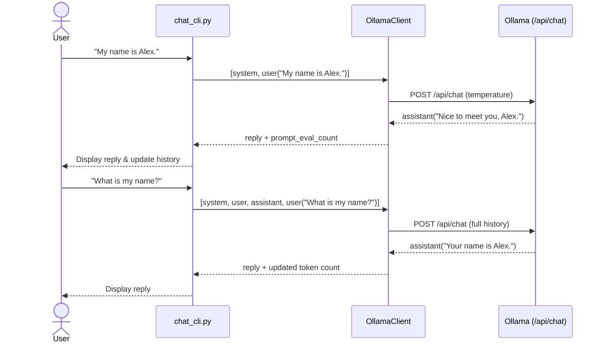

<div align="center">

# 🧠 TalentGraph AI — Local LLM Playground

**A lightweight, zero-framework Python playground for running and experimenting with local LLMs via Ollama.**

[](https://www.python.org/)
[](https://ollama.com/)
[](https://requests.readthedocs.io/)
[](#)

</div>

---

## 🎯 Project Objective

Build a clean, understandable Python application that communicates with locally downloaded Large Language Models—**without OpenAI, Gemini, or heavy orchestration frameworks**—to understand the core engineering behind local inference.

### What This Playground Covers

| Concept | Engineering Implementation |
| :--- | :--- |
| **Local LLM Inference** | Communicates directly with Ollama's local REST server (`http://localhost:11434/api/chat`) |
| **Parameters & Quantization** | Runs compact 4-bit quantized models (`llama3.2:1b` and `qwen2.5:0.5b`) on consumer hardware |
| **Prompt Engineering** | Separates the `system` persona/instructions from `user` and `assistant` turns |
| **Sampling Control** | Configures `temperature` via Ollama's `options` payload to test deterministic vs. creative outputs |
| **Stateless APIs & Memory** | Maintains a client-side `history` list with a sliding window (`--max-turns`) |
| **Persistence** | Saves conversations and hyperparameters to timestamped JSON files (`saved_chats/`) |
| **Model Benchmarking** | Compares two models side by side on the exact same prompt, measuring throughput (`tok/s`) and latency |

---

## 🏗️ Architecture & Visual Flow

### System Overview



### How Multi-Turn Conversation Memory Works

Because LLM REST APIs are **stateless**, the Python client tracks the conversation and re-sends the context window on every turn:



---

## 📁 Project Structure

```text
Local_LLM_playground/
├── ollama_client.py     # Lightweight REST client wrapping Ollama's /api/chat endpoint
├── chat_cli.py          # Interactive CLI chat loop with system prompts, temperature, history & JSON save
├── compare_models.py    # Side-by-side comparison & throughput benchmark across two local models
├── requirements.txt     # Minimal dependency list (requests)
├── .gitignore           # Excludes __pycache__, virtualenvs, and local saved_chats/
└── README.md            # Project documentation
```

---

## 🚀 Getting Started

### 1. Prerequisites
1. Install **[Ollama](https://ollama.com/download)** and ensure the background daemon is running (`http://localhost:11434`).
2. Pull the small instruct models used in this playground:
   ```bash
   ollama pull llama3.2:1b
   ollama pull qwen2.5:0.5b
   ```
3. Install Python dependencies (Python 3.10+ recommended):
   ```bash
   pip install -r requirements.txt
   ```

---

## 💻 Usage

### 1. Test the Python Client (`ollama_client.py`)
Runs a single test prompt and prints response throughput metrics:
```bash
python ollama_client.py
```

### 2. Interactive Chat (`chat_cli.py`)
Start the CLI chat loop with optional flags:
```bash
python chat_cli.py --system "You are a concise Python tutor." --temperature 0.2 --max-turns 10
```

**CLI Flags:**
- `--system`: Initial system prompt (if omitted, prompts interactively at startup).
- `-t`, `--temperature`: Sampling temperature `>= 0.0` (default: `0.7`).
- `--max-turns`: Sliding window of recent conversation turns to keep (`0` = unlimited, default: `10`).

**In-Chat Commands:**
| Command | Action |
| :--- | :--- |
| `/system <prompt>` | Update the active system prompt mid-session (or view current if empty) |
| `/temp <value>` | Change sampling temperature live (e.g., `/temp 0.0` vs `/temp 1.5`) |
| `/history` | Print all messages currently stored in conversation history |
| `/clear` | Clear conversation history while keeping system prompt and temperature |
| `/save [name]` | Save conversation + metadata as JSON in `saved_chats/` |
| `exit` or `quit` | Exit the chat cleanly |

### 3. Compare Two Models (`compare_models.py`)
Send the exact same prompt and hyperparameters to two models and compare output + speed:
```bash
python compare_models.py --prompt "Explain quantization in LLMs in two short sentences." --temperature 0.0
```
*(You can also pass custom models with `--models <model_a> <model_b>`.)*

**Example Output:**
```text
=== Model Comparison ===
System prompt: You are a helpful, concise AI assistant.
Temperature:   0.0
User prompt:   Explain quantization in LLMs in two short sentences.

--- Model: llama3.2:1b ---
...
[Metrics] tokens=82 | speed=87.4 tok/s | total_wall_time=6.85s

--- Model: qwen2.5:0.5b ---
...
[Metrics] tokens=50 | speed=194.2 tok/s | total_wall_time=3.44s
```

---

## 🛠️ Tech Stack

- **Runtime:** [Ollama](https://ollama.com/)
- **Language:** Python (standard library: `argparse`, `json`, `pathlib`, `datetime`, `time`, `typing`)
- **HTTP Client:** `requests`
